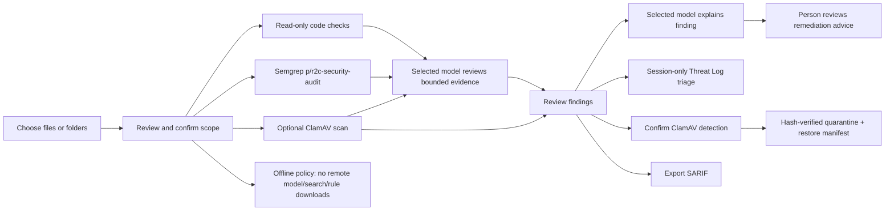

# Architecture

**Overview last updated: 2026-10-29.** This document describes the current
top-level SecAudit wrapper, not the separate upstream Strix checkout.

## Additional background checks

Each confirmed audit runs bounded supplier-intake, AI-code, and shadow-automation
static indicators in the scan worker against only the selected paths. Their findings
and coverage status are added to the ordinary report. Supplied files are not
executed, and a heuristic intake status is not a supplier certification.

When a prior audit has findings, the next audit compares them with results from its
currently confirmed scope. It reports `still detected`, `not reproduced in static
re-check`, or `inconclusive`; a missing pattern is never described as proof of a
verified fix or as evidence of runtime exploitability. A changed scope or incomplete
check produces an inconclusive result.

Bundle, risk-register, and audience-report helpers remain backend utilities, but
their former dedicated controls are not shown in the desktop UI. Operations that
need a user-selected artifact, an output path, or a human risk decision are not
started automatically.

The Settings page's app-level offline option is persisted in the ignored local environment file. It blocks Cloud requests, public search, non-loopback model endpoints, remote Semgrep rule-pack resolution, model pulls, and ClamAV signature downloads. Offline audits may use the local pattern scanner, local ClamAV signatures, and loopback local models. Network diagnostics in this mode test only loopback and suppress gateway, public-IP, and DNS probes. This policy is not an operating-system firewall and cannot prove the host emitted no network traffic; regulated or air-gapped deployments must enforce egress restrictions outside SecAudit. Offline update bundles can be created or integrity-checked, but are not installed by the bundle verifier.

Offline bundle verification requires a signed manifest bundle containing `manifest.json`, `signature.ed25519`, and `public_key.pem`; hashes and the Ed25519 signature are checked locally. A successful check proves bundle integrity only, not the trustworthiness of the signing key or update contents. Risk-register and bundle helpers are not exposed as automatic or GUI actions.
SecAudit combines predictable local scanners with optional language-model
assistance. Scanners produce evidence; models explain evidence and draft response
plans. Models do not execute arbitrary shell commands or make file changes.

For a plain-language overview of the screens and user-facing features, see
[SecAudit application functions](./application-functions.md).

## User flow

## Components

| Component | Responsibility |
| --- | --- |
| `llm_app/ui/main_window.py` | Native PyQt6 widget interface, folder selection, progress, assistant, and results |
| `llm_app/ui/dev_window.py` | Dev Toolkit screens and Batch Review report rendering on a bounded Qt worker pool |
| `llm_app/dev_toolkit/engine.py` | Read-only bounded static analysis, finding normalization, behavior correlation, and file-level coverage |
| `llm_app/dev_toolkit/intake.py` | Supported-file discovery, chunked bounded reads, and streaming SHA-256 calculation |
| `llm_app/dev_toolkit/models.py` | Finding contract, analysis limits, and coverage/result serialization |
| `llm_app/core/strix_engine.py` | Scoped source/config pattern checks, Semgrep and ClamAV adapter coordination, finding collection, SARIF export |
| `llm_app/core/semgrep_scanner.py` | Bounded Semgrep CLI invocation and JSON-to-finding/coverage mapping |
| `llm_app/core/clamav_scanner.py` | Bounded one-shot and loopback daemon scans, coverage parsing, and session daemon lifecycle |
| `llm_app/core/semgrep_warmup.py`, `clamav_warmup.py` | Background version + functional probes and persisted scanner readiness |
| `llm_app/core/scanner_state.py` | Atomic persistence of bounded, local scanner probe state |
| `llm_app/core/processes.py` | Argument-array process launching, output caps, cancellation, and Windows Job Object containment |
| `strix/report/` | Finding state and SARIF report helpers reused by the draft app |
| `llm_app/core/ollama_client.py` | Qwen2.5 low-complexity local review |
| `llm_app/core/local_model_backend.py` | Vendor-neutral local model routes and model management over Ollama's HTTP API |
| `llm_app/core/security_review.py` | Bounded file/scan evidence review, model escalation, and cloud-only routing |
| `llm_app/core/workflow_skills.py` | Built-in review guidance and bounded, locally stored custom workflow profiles |
| `llm_app/core/learning_memory.py` | Bounded local report archive, redacted scan memory, assistant report context, and learned-profile guidance |
| `llm_app/core/openrouter_client.py` | OpenRouter cloud requests |
| `llm_app/core/pipeline.py` | General assistant routing with exclusive Cloud mode |
| `llm_app/core/enterprise_features.py` | Supplier and automation indicators, risk register, audience reports, bundle integrity checks, and static fix-comparison status |
| `llm_app/core/file_assessment.py` | Bounded, read-only file metadata and offline Authenticode inspection; no execution |
| `llm_app/core/report_import.py` | Bounded, redacted import of user-selected text, Markdown, JSON, and SARIF chat context |
| `llm_app/core/evidence_pack.py` | Passphrase-encrypted local Ed25519 signing key, signed report bundles, hash-chain ledger, and bounded integrity verification |
| `llm_app/core/network_monitor.py` | Local interface counters and explicitly confirmed, read-only connectivity checks |
| `llm_app/core/authenticode.py` | Offline WinVerifyTrust checks for selected Windows PE files |
| `cyber-guardian/` | Separate upstream Strix checkout with its own model context manager and selectable security skills; the desktop wrapper does not invoke it for folder scans |

The desktop shell is Python and native PyQt6 widgets; it does not use Qt WebEngine,
HTML, or a JavaScript bridge. Qt's widget implementation is native C++. SecAudit
does not yet have project-owned C++ or Rust modules. Keep scanning orchestration and
provider policies in Python; move a measured hot path or reliability-critical
primitive to C++ or Rust only behind a narrow interface, with a Python fallback and
parity checks before making it the default.

## Optional scanner lifecycle

The full audit path alone invokes Semgrep and ClamAV; Dev Toolkit Batch Review always
reports both as `NOT RUN`. Startup probes run off the UI thread after the window
appears and are repeated after 24 hours, an engine-version change, or an engine-level
failure. Probe records include the timestamp, duration, engine version, and verdict.

Semgrep resolution never uses Python 3.15. It prefers a previously verified configured
path, then the known Python 3.12 Scripts location, PATH, and finally
`py -3.12 -m semgrep`. A successful `--version` is insufficient: the engine must detect the
expected finding in a generated local fixture. Audit invocations use a fixed argument
list, bounded JSON output, two jobs, a fixed timeout, and only the user-confirmed
target paths. Offline mode uses the bundled local rules and never resolves a remote
pack. Coverage records the rule source, duration and warm-up classification, scanned
and skipped paths, engine verification, errors, and fallback state.

ClamAV engine verification similarly requires a version response and a successful
local custom-signature detection plus clean-fixture scan. Malware checks additionally
require an app-managed signature database no older than 72 hours. One-shot scans use
bounded file/scan sizes, recursion and file-count limits. The optional warm daemon is
owned by the current SecAudit process, binds only to `127.0.0.1`, is never installed as
a Windows service, and is disclosed as using about 1–1.5 GB of RAM. Failed daemon
startup falls back to one-shot scanning with the reason recorded; graceful close stops
the daemon. FreshClam updates are blocked by offline mode, then trigger a daemon reload
(restart fallback) and a fresh verification probe. The report compares ClamAV's
scanned-file summary with the bounded regular-file intake count; missing summaries,
intake limits, or a lower scan count are marked incomplete.

Each Semgrep scan process uses its own kill-on-close Windows Job Object. SecAudit
itself also uses a kill-on-close Job Object so child tools and descendants are cleaned
up if the app is hard-killed. Graceful close requests cancellation and stops children;
hard termination is not intercepted. The on-disk scan journal supports recovery and
requires the user to confirm the scope again after restart. Closing the window during
work does not wait on a modal confirmation; workers receive cancellation and a bounded
shutdown period.

All nine desktop screens are scrollable. Shared DPI-aware sizing keeps entry controls
at least 5 mm high and text outputs, lists, tables, and progress bars at least 16 mm
high at the active display scale. Read-only text wraps to the widget width, tables
resize rows to their contents, and form fields expand instead of compressing their
values into a narrow viewport.

The Dev page is a native Qt page with File Trust Evidence, Batch Review, Regex Lab,
and Code Wikipedia tabs. Batch Review publishes its bounded result into the Reports
window's Dev Toolkit section. Its deterministic core lives under
`llm_app/dev_toolkit/`: bounded intake and hashing, YAML rule packs, isolated regex
workers, encoded-input classification/decoder evidence, trust/provenance checks,
local FTS5-backed CodeWiki storage, graph exporters, and hash-checked evidence packs.
Supplied content is read-only and is never executed; quarantine is only described
until a separate existing confirmation path is used.

Batch Review accepts up to 200 files, at most 4 MiB per file and 64 MiB total.
Intake reads in 64 KiB chunks; over-limit files are explicitly skipped. Its findings
carry the normalized contract (rule and correlations, line range, behavior, redacted
excerpt, parsed command arguments, independent detection/threat certainty, MITRE,
nullable validated CWE, severity, and status). Correlation requires the same file,
line range, and explicit behavior class; severity is the maximum of merged
indicators, and unrelated same-line behaviors remain separate. Rule references are
not treated as proof that a CWE applies.
The Batch Review text view groups consecutive same-class detections into behavioral
blocks with the covered line range and sub-match count. The emitted structured result
keeps raw per-line findings and correlation metadata so that grouping does not discard
evidence. Windows privilege, registry, and persistence rules have separate IDs and
rule-owned categories; compound command separators are parsed before arguments.

The Batch Review worker pool is limited to one thread. UI progress is coalesced by
file batch, cancellation is checked between files, and report rendering runs off the
UI thread. Semgrep and ClamAV are not invoked by this workflow; their coverage is
`NOT RUN`, never clean. A local journal preserves scan state for next-launch
interruption notice and scope re-confirmation. Windows startup places SecAudit and
its subprocess tree in a kill-on-job-close Job Object; graceful close requests
cancellation and terminates child processes before exiting. Hard termination cannot
be intercepted, so the journal is the recovery mechanism.

## Security submodels

The intended model roles are small and distinct so a new user can understand what is
happening:

1. **Triage:** group scanner evidence by type and explain confidence and limitations.
2. **Investigation:** explain the finding in plain language and identify what evidence
   supports it.
3. **Remediation planner:** draft reversible next steps and note prerequisites.
4. **Reviewer:** optionally compare the draft with current public advisories through
   web search or a cloud model, after the user enables those services.

In Local mode, the configured Ollama first-pass model reviews up to 80 supported files.
Files with scanner findings or notable model observations can be escalated to a second
installed Ollama model. The assistant also routes medium/high requests to that second
model when the first-pass classifier requests escalation, confidence is low, or the
request tier is not low. Both roles use the same local host, configured context and
temperature. Model names are editable and can be pulled or removed from Settings;
context and temperature are selected when creating a tuned model profile. The default installed model names are suggestions; the
app checks the actual Ollama inventory and reports missing models.

`llm_app/core/local_model_backend.py` is the vendor-neutral inference boundary. The
desktop backend uses the Ollama HTTP API and does not depend on NVIDIA NIM, NeMo,
CUDA, or NVIDIA hardware. Ollama may use an accelerator supported by the host system.
The architecture takes the general evidence-stage pattern from the supplied
vulnerability-analysis reference, but this app does not implement container extraction,
public CVE research, exploit testing, or automatic VEX policy decisions. Findings and
model observations remain separate, reviewable evidence. Reports state the selected
model roles, completed checks, skipped files, limits, and partial failures.

Completed audits are archived locally with bounded finding details so the Assistant
can answer questions about a user-selected report. Cloud chat sends that report only
after a separate disclosure confirmation. Each audit also adds a redacted aggregate
memory record (profile, check status, finding category, and severity counts); full
source files and raw excerpts are excluded. Loopback Local model reviews may use these
records as weak historical context. The **Train** action aggregates saved memory into
a new Ollama system-prompt profile and selects it as the higher-tier reviewer; it does
not fine-tune model weights. It is disabled for Cloud mode and non-loopback Ollama
hosts. The Memory window supports inspection, forgetting individual records, clearing
all learned summaries, or clearing saved reports separately. Retention is bounded to
500 memory records and 100 reports.

The Assistant can optionally search public sources when the user enables search for a
request. Its details panel lists the models, selected report, and search URLs
used for the last answer, along with relevant assumptions and evidence limits. Saved
or imported report attachment is opt-in per request. Imported JSON/SARIF, Markdown, and
plain-text reports are capped at 2 MiB on disk and 12,000 characters in model context;
credential-like values are redacted and the imported content is marked untrusted.
Cloud disclosure remains required before an attached imported report is sent.

The File review page calculates a bounded SHA-256 digest, identifies common file
headers, and checks local Authenticode status for supported Windows formats. It does
not run an installer, executable, PowerShell script, batch file, shell script, archive
member, or any other selected content. A Python virtual environment is not a security
sandbox. The page can add a reviewed file to the explicit New Audit scope, where the
available static and malware-signature checks can run under the existing scan
confirmation. Hashing stops at 256 MiB; ZIP members are not opened on the File review
page. Signature validity is publisher evidence, not a safety verdict.

The Network page displays active interface addresses, OS-reported link speed, and
upload/download byte-counter rates while the page is open. Optional diagnostics require
a click and confirmation, then perform bounded pings to loopback, the detected gateway,
and 1.1.1.1 plus a DNS lookup for example.com. They do not change host configuration.
ICMP filtering can make ping results inconclusive; the monitor is not a full packet
capture, a throughput benchmark, or proof that a connection is safe.

Network status and diagnostic work runs in Qt background workers. Windows route,
Wi-Fi, ping, and DNS commands use fixed absolute system executable paths, argument
arrays, bounded timeouts, redirected input/output, and `CREATE_NO_WINDOW`; no command
shell, terminal window, or user-supplied command is involved. The Reports **Network**
tab shows a live local snapshot (gateway, Wi-Fi SSID when available, active IPv4
interfaces, reported link speed, byte totals and measured rates) and any explicitly
confirmed diagnostic results. This live network view is not appended to exported audit
copies or saved scan evidence.

Runtime CLI work across the desktop wrapper uses the shared
`llm_app/core/processes.py` helper: commands are argument arrays, shell invocation is
rejected, stdin is non-interactive, output is captured instead of appearing in a
terminal, and Windows console windows are suppressed. On POSIX systems commands start
in a separate process session. Scanning, Semgrep, ClamAV/FreshClam, report provenance,
network diagnostics, model management, and scanner warm-up are launched from Qt workers. Bounded
commands finish or are stopped at their timeout before the worker returns and the
audit report is finalized. The explicitly started Ollama serving daemon is the
exception: it is a persistent local model service, started hidden and not owned by a
single audit report.

Local folder scans inspect supported script and text members inside ZIP archives without
extracting them. Archive processing is capped at 2,500 entries, 100 MiB uncompressed
content per archive, and 5 MiB per reviewed text member. ClamAV handles virus signatures
when installed with current signatures. Windows PE files are checked with the local
Authenticode trust API; ZIP-contained executables can be checked for an embedded
signature table, but publisher trust is not verified from inside the archive.

In Cloud mode, OpenRouter receives bounded evidence directly. The app does not probe
or invoke Ollama and does not fall back to local models if the key or request fails.
Before a scan sends source excerpts to the cloud, the UI asks for confirmation.
The app does not fine-tune model weights. Scanner output and file contents are
untrusted input, including instructions embedded in source files; models cannot run
commands or alter scan results. User files are not used for training by this app.

## Scan boundaries

- The user selects and confirms up to 20 files or directories for each scan; there is
  no default project target. Individual files are supported directly.
- Audit setup supports general, telemetry, telecom-configuration, and
  vulnerability-inventory review focuses, plus user-created workflow guidance. The
  Skills screen explains review stages and lets users create, edit, or remove up to
  30 local profiles. These instructions guide bounded model review; they do not change
  the scanner set, execute commands, or change selected paths. Profiles are stored in
  the user's app data directory.
- Code-pattern checks read selected text formats, skip symlinks, common generated or
  dependency directories, and files over 5 MiB.
- Semgrep, ClamAV, model review, supported-file counts, and skip reasons appear in the
  report's check-coverage table. An unsupported file type is counted as skipped.
- The monitor shows elapsed time, current stage, file coverage, findings, and completed
  check count. Reports use separate Findings, Checks and coverage, and Details tabs so
  tables and evidence can use the available window space.
- ClamAV runs only when the executable and a recent app-managed signature database are
  available. Missing or stale signatures are reported as an unavailable check; users
  can update the app-managed signatures from Settings. The optional loopback daemon
  loads the database once per app session; one-shot fallback and its reason appear in
  scan details.
- Semgrep and ClamAV are not declared available after a version response alone.
  Successful local functional probes are required, and startup readiness is shown in
  Run Monitor and Settings.
- The scan is read-only. It does not run or edit target files. A separate, confirmed
  action can move only a ClamAV-detected regular file into app quarantine; a
  hash-verified manifest supports restoration and existing files are never overwritten.
- A local folder scan is static review, not a penetration test and not a guarantee of
  malware absence.
- Strix dynamic testing is a separate advanced workflow. Before it is enabled, the
  app must show the exact target and require the user to confirm authorization.
- Models review up to 80 file excerpts per folder scan (up to 20,000 characters
  each, scaled to the configured Ollama context); the report records provider,
  coverage, and whether the review was partial.
- Cloud mode sends evidence only after scan confirmation. Provider failures are shown
  in scan status and never silently switch providers.
- Threat Log triage labels are session-only analyst annotations. They do not modify
  scanner findings, SARIF output, or target files.
- Signed evidence packs contain the saved redacted report and SARIF plus a signed
  hash-chain ledger. The signing key is encrypted with a user-provided passphrase and
  remains in local app data. The pack's public key is self-signed; signer identity
  requires out-of-band fingerprint verification. No external timestamping or
  compliance-framework mapping is claimed.
- Strix report telemetry is disabled by default in the desktop wrapper.

## Fixed lab tool adapters

Tool adapters are explicit, fixed, and optional. Each adapter checks whether its
binary exists, shows the exact operation to the user, uses an argument list without a
shell, applies time and output limits, and reports a missing tool without failing the
whole app. The model cannot select arbitrary programs or construct unrestricted
commands.

Network-capable adapters must call the lab-scope validator before execution.
`lab_targets.txt` is an allow-list boundary, not a default target list. Invalid
or out-of-scope targets are rejected and written to the local rejection log;
the UI displays the authorized-lab banner. Current host diagnostics test only
loopback and allow-listed lab addresses, never public IPs or DNS.

The fixed lab adapters live in `llm_app/core/lab_tool_runner.py`. They resolve
the verified executable from `llm_app/core/capabilities.py`, use argument arrays,
capture bounded output, stream parsed events to the Network tab, and record
timeout/limit/exit status. They are not general shell access and models cannot
choose their arguments.

The reviewed custom guidance pack under `cyber-guardian/strix/skills/custom` is
bundled as bounded, review-only profiles. It is loaded into the same model-guidance
path as the built-in profiles, with an explicit safety wrapper; it cannot add scan
targets, select executables, or grant permissions. Duplicate source documents are
deduplicated when loaded.

Approved lab execution records a redacted JSONL audit event under the app's local
settings directory. Records include the fixed command digest, selected permission
profile, target, outcome, exit code, and whether the current process was elevated.
Secrets are redacted and audit-write failure does not turn a failed or incomplete
tool run into success.

The separate upstream Strix checkout includes optional agent-facing skills, but
folder audits in this Qt app do not load or invoke those documents, agents, or any
vendor container. SecAudit has its own bounded review profiles, including static
source/trust-boundary analysis, dependency evidence review, counterevidence
assessment, and static fix review. These profiles guide interpretation of the
confirmed scope and fixed scanner evidence only; they do not execute code, invoke
tools, contact targets, or close findings. This keeps the desktop backend usable
on ordinary Windows systems with the locally configured Ollama runtime.

The Network page is organized into Connected network, Diagnose network, and Tool
runner tabs. Diagnostics report bounded local observations, start/end times,
TCP/IP counts, DNS configuration counts, adapter signal fields where available,
and current/session-average rates without displaying private addresses or peer
identities. RSRP/RSRQ are explicitly unavailable when the adapter does not expose
cellular metrics.

Offline Semgrep runs the reviewed bundled local rules at
`llm_app/dev_toolkit/rules/semgrep-local.yml`; online scans may use the remote
`p/r2c-security-audit` pack. No rule-pack download occurs in offline mode.

The Code Wikipedia index accepts shell, Windows command, markup, PHP, Rust, C/C++,
Java, TypeScript/JavaScript, Python, and other bounded source files. It indexes
read-only text and never executes them.
